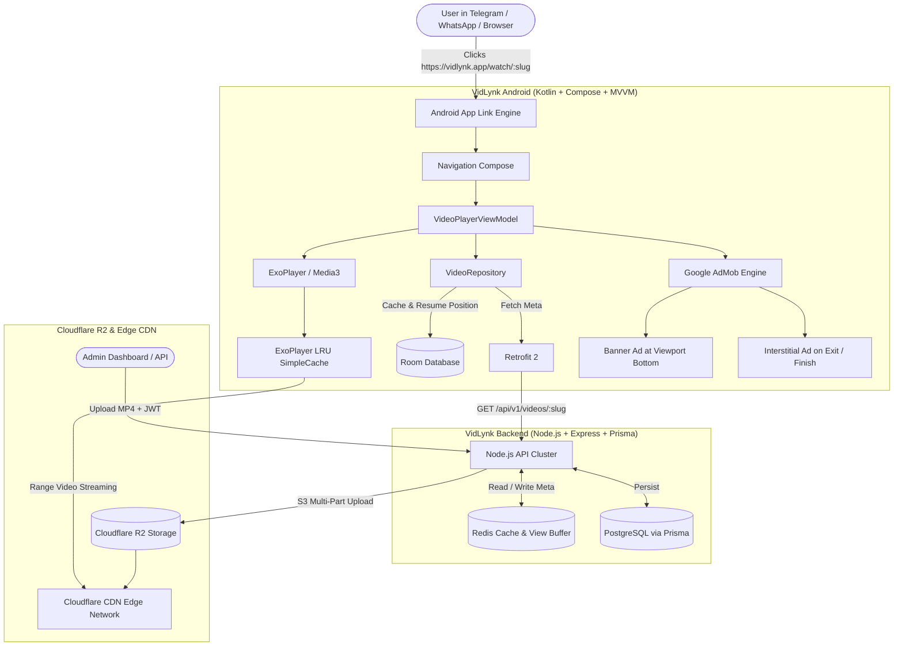

# VidLynk - High-Throughput Deep Link Video Streaming Platform

Production-ready, zero-friction video streaming system. When users click a VidLynk link in Telegram, WhatsApp, Instagram, or a web browser, the Android app opens directly and starts streaming the video with zero user friction (no login/signup required), monetized with Google AdMob.

---

## 🏗️ Architecture Overview



---

## 📁 Repository Structure

```
.
├── backend/                  # Node.js + Express + TypeScript + Prisma + Redis + R2
│   ├── src/
│   │   ├── config/           # Redis, Prisma, Cloudflare R2 / S3, Environment
│   │   ├── controllers/      # Admin (upload/manage), Auth (JWT), Video (public lookup)
│   │   ├── middlewares/      # Auth guard, Multer media filter, Error handler
│   │   ├── routes/           # Admin, Auth, Video & .well-known routes
│   │   ├── services/         # StorageService (R2), RedisService (cache/views), VideoService
│   │   ├── app.ts            # Express setup & CORS / Helmet security
│   │   └── server.ts         # Server bootstrapper & DB connection
│   ├── prisma/
│   │   ├── schema.prisma     # Video, Admin schemas with optimized indexes
│   │   └── seed.ts           # Admin account seeder
│   ├── Dockerfile            # Multi-stage optimized Docker build
│   └── docker-compose.yml    # Full stack: Postgres + Redis + Node.js API
│
└── android/                  # Android Studio Project (Kotlin DSL)
    ├── app/
    │   ├── src/main/
    │   │   ├── AndroidManifest.xml   # Deep link filters (HTTPS + custom scheme) & AdMob
    │   │   └── java/com/vidlynk/app/
    │   │       ├── core/
    │   │       │   ├── ads/          # AdMob Manager & Compose BannerAdView
    │   │       │   └── di/           # Hilt Modules (Network, Database, Player, Repo)
    │   │       ├── data/
    │   │       │   ├── local/        # Room Database (watch history & resume position)
    │   │       │   ├── model/        # Video DTOs
    │   │       │   ├── remote/       # Retrofit Api service
    │   │       │   └── repository/   # Offline-first VideoRepository
    │   │       ├── ui/
    │   │       │   ├── navigation/   # NavGraph with deep link route injection
    │   │       │   ├── screens/
    │   │       │   │   ├── home/     # Recently watched streams & manual link player
    │   │       │   │   └── player/   # ExoPlayer Media3 Screen with playback resume
    │   │       │   └── theme/        # Dark Material Design 3 cinematic theme
    │   │       ├── VidLynkApp.kt     # Application class with AdMob & Hilt init
    │   │       └── MainActivity.kt   # Deep link dispatcher & singleTask activity
    │   └── build.gradle.kts
    └── gradle/libs.versions.toml     # Gradle Version Catalog
```

---

## 🚀 Quick Start Guide

### 1. Run the Backend

```bash
cd backend

# 1. Start Postgres & Redis using Docker
docker-compose up postgres redis -d

# 2. Run migrations and seed default admin
npm run prisma:migrate
npm run seed     # Default admin: admin@vidlynk.app / VidLynkAdmin2026!

# 3. Start development server
npm run dev
```

### 2. Admin Video Upload Example

```bash
# 1. Login to get JWT
curl -X POST http://localhost:5000/api/v1/auth/login \
  -H "Content-Type: application/json" \
  -d '{"email":"admin@vidlynk.app","password":"VidLynkAdmin2026!"}'

# 2. Upload video
curl -X POST http://localhost:5000/api/v1/admin/videos/upload \
  -H "Authorization: Bearer <YOUR_TOKEN>" \
  -F "title=Epic 4K Wildlife Clip" \
  -F "video=@sample.mp4"
```

Response:
```json
{
  "success": true,
  "data": {
    "slug": "vl_Xy78a9Bc",
    "shareUrl": "https://vidlynk.app/watch/vl_Xy78a9Bc"
  }
}
```

### 3. Test Deep Linking in Android via ADB

Run the app on an emulator or connected device:

```bash
# Test HTTPS App Link (from Telegram / WhatsApp)
adb shell am start -a android.intent.action.VIEW -d "https://vidlynk.app/watch/vl_Xy78a9Bc" com.vidlynk.app

# Test Custom Scheme
adb shell am start -a android.intent.action.VIEW -d "vidlynk://watch/vl_Xy78a9Bc" com.vidlynk.app
```
